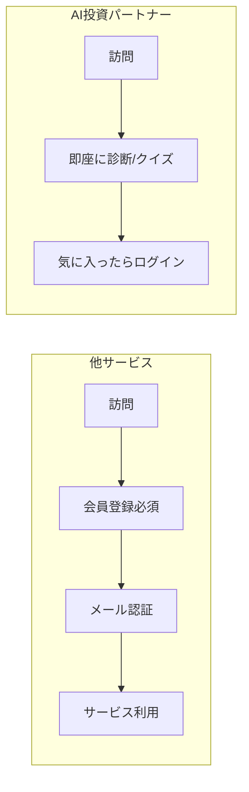

# 競合分析

AI投資パートナーの市場ポジションと競合サービスとの比較を分析します。

---

## 市場概要

### 投資学習アプリ市場

| 項目 | 内容 |
|------|------|
| **市場規模** | 国内個人投資家数：約2,000万人（増加傾向） |
| **成長要因** | NISA拡充、投資教育の義務化、若年層の関心増 |
| **トレンド** | AI活用、ゲーミフィケーション、短時間学習 |

### ターゲット市場

```
┌─────────────────────────────────────────────────┐
│                                                 │
│         ┌───────────────────────┐              │
│         │    経験者向け        │              │
│         │   （証券アプリ）     │              │
│         └───────────────────────┘              │
│                                                 │
│    ┌─────────────────────────────────┐         │
│    │                                 │         │
│    │   初心者向け学習                │ ← 私たち │
│    │   （AI投資パートナー）          │         │
│    │                                 │         │
│    └─────────────────────────────────┘         │
│                                                 │
│              ┌───────────────────┐              │
│              │   超初心者向け   │              │
│              │   （家計簿アプリ）│              │
│              └───────────────────┘              │
│                                                 │
└─────────────────────────────────────────────────┘
```

---

## 競合サービス比較

### 直接競合

| サービス | 特徴 | 価格 | 弱点 |
|---------|------|------|------|
| **株たす** | 投資シミュレーション | 無料 | 学習要素が弱い |
| **トウシカ** | 投資練習アプリ | 無料 | ニュース連動なし |
| **投資の達人** | 投資クイズアプリ | 無料/有料 | AI個別化なし |

### 間接競合

| サービス | 特徴 | 価格 | 弱点 |
|---------|------|------|------|
| **楽天証券** | 証券取引アプリ | 無料 | 学習目的ではない |
| **SBI証券** | 証券取引アプリ | 無料 | 初心者には複雑 |
| **マネーフォワード** | 家計管理 | 無料/有料 | 投資学習なし |
| **日経電子版** | ニュースメディア | 有料 | インタラクティブでない |

---

## 競合機能比較表

| 機能 | AI投資パートナー | 株たす | トウシカ | 楽天証券 |
|------|:---------------:|:------:|:-------:|:-------:|
| **投資スタイル診断** | ✅ AI個別化 | ❌ | △ 簡易版 | ❌ |
| **デイリークイズ** | ✅ AI生成 | ❌ | ✅ 手動作成 | ❌ |
| **ゲーミフィケーション** | ✅ | △ | ✅ | ❌ |
| **ニュース連動** | ✅ 毎日更新 | ❌ | ❌ | ✅ |
| **ログイン不要** | ✅ | ❌ | ❌ | ❌ |
| **実際の取引** | ❌ | △ シミュレーション | △ シミュレーション | ✅ |
| **推奨銘柄** | ✅ AI提案 | ❌ | ❌ | ✅ 有料 |

---

## 差別化ポイント

### 1. AI診断による個別化

| 比較項目 | AI投資パートナー | 他サービス |
|---------|----------------|-----------|
| **診断方法** | Gemini AIによる分析 | 固定ロジック |
| **結果の深さ** | 8タイプ + 個別アドバイス | 3-5タイプ程度 |
| **推奨銘柄** | タイプに応じて提案 | なし or 一律 |

### 2. 登録不要での体験



| 比較 | 登録必須サービス | AI投資パートナー |
|------|-----------------|----------------|
| 初回ハードル | 高い | **低い** |
| 離脱率 | 高い | **低い** |
| 体験までの時間 | 5-10分 | **0分** |

### 3. ニュース連動のリアルタイム性

| 比較項目 | AI投資パートナー | 他の学習アプリ |
|---------|----------------|---------------|
| **コンテンツ更新** | 毎日7時に自動生成 | 週1回 or 不定期 |
| **ニュースソース** | 当日のニュース | 過去の事例 |
| **学習の実践性** | 高い | 低い |

### 4. ゲーミフィケーション設計

| 要素 | AI投資パートナー | 株たす | トウシカ |
|------|:---------------:|:------:|:-------:|
| 経験値 | ✅ | ❌ | ✅ |
| レベル | ✅ | ❌ | ✅ |
| 連続ボーナス | ✅ | ❌ | ❌ |
| ランキング | 🔜 将来 | ✅ | ✅ |
| バッジ | 🔜 将来 | ❌ | ✅ |

---

## SWOT分析

```
┌─────────────────────────┬─────────────────────────┐
│        強み (S)         │        弱み (W)         │
├─────────────────────────┼─────────────────────────┤
│ ・AI診断の個別化        │ ・実取引機能なし       │
│ ・登録不要UX            │ ・リアルタイム更新なし  │
│ ・ゲーミフィケーション  │  （バッチ処理のため）  │
│ ・低コスト運用          │ ・コミュニティ機能なし │
│ ・毎日更新のコンテンツ  │ ・認知度が低い         │
├─────────────────────────┼─────────────────────────┤
│        機会 (O)         │        脅威 (T)         │
├─────────────────────────┼─────────────────────────┤
│ ・NISA拡充による       │ ・大手証券の機能追加   │
│   投資人口増加          │ ・金融規制の強化       │
│ ・投資教育の義務化      │ ・AI技術のコモディティ化│
│ ・若年層の投資関心増    │ ・競合の参入           │
│ ・ESG投資への関心       │                        │
│ ・法人研修市場          │                        │
└─────────────────────────┴─────────────────────────┘
```

### SWOT戦略

| 戦略 | 内容 |
|------|------|
| **SO戦略**<br/>（強み×機会） | AI診断の独自性を活かし、NISA初心者層を獲得 |
| **WO戦略**<br/>（弱み×機会） | 法人研修市場で「学習特化」をポジションに |
| **ST戦略**<br/>（強み×脅威） | ゲーミフィケーションで大手と差別化 |
| **WT戦略**<br/>（弱み×脅威） | 証券会社と連携し、取引機能を補完 |

---

## ポジショニングマップ

### 軸1: 学習特化 vs 取引特化

```
            学習特化
               ↑
               │
    ┌──────────┼──────────┐
    │          │          │
    │  AI投資  │  投資の  │
    │  パートナー │  達人   │
    │    ★     │          │
    │          │          │
初心者─────────┼──────────→ 経験者
    │          │          │
    │  株たす  │  楽天    │
    │  トウシカ │  証券   │
    │          │          │
    └──────────┼──────────┘
               │
               ↓
            取引特化
```

### 軸2: エンタメ性 vs 実用性

```
            エンタメ性
               ↑
               │
    ┌──────────┼──────────┐
    │          │          │
    │  株たす  │  AI投資  │
    │          │  パートナー │
    │          │    ★     │
    │          │          │
低コスト───────┼──────────→ 高品質
    │          │          │
    │  無料    │  日経    │
    │  ブログ  │  電子版  │
    │          │          │
    └──────────┼──────────┘
               │
               ↓
            実用性
```

---

## 競争優位の持続性

### 短期的な優位性（1-2年）

| 優位性 | 持続性 | 理由 |
|--------|--------|------|
| AI診断の個別化 | ⚠️ 中程度 | 技術的には模倣可能 |
| 登録不要UX | ✅ 高い | 既存サービスの変更は困難 |
| ゲーミフィケーション | ⚠️ 中程度 | 設計のノウハウが必要 |

### 長期的な優位性（3年以上）

| 優位性 | 持続性 | 理由 |
|--------|--------|------|
| ユーザーデータ蓄積 | ✅ 高い | 先行者利益 |
| ブランド認知 | ✅ 高い | 時間と投資が必要 |
| コミュニティ（将来） | ✅ 高い | ネットワーク効果 |

---

## 競合対策

### 大手証券の参入に対して

| 対策 | 内容 |
|------|------|
| **差別化強化** | 「学習特化」のポジションを明確に |
| **先行者利益** | ユーザーベースとデータを早期に構築 |
| **ニッチ戦略** | 「投資初心者」に特化し続ける |

### 類似サービスの参入に対して

| 対策 | 内容 |
|------|------|
| **機能拡充** | ランキング、コミュニティなど付加価値 |
| **UI/UX改善** | 継続的な体験向上 |
| **コンテンツ品質** | AI生成の精度向上 |

---

## 関連ドキュメント

- [プロダクト概要](./PRODUCT_OVERVIEW.md) - サービスの価値提案
- [マーケティング素材](./MARKETING_ASSETS.md) - 差別化メッセージ
