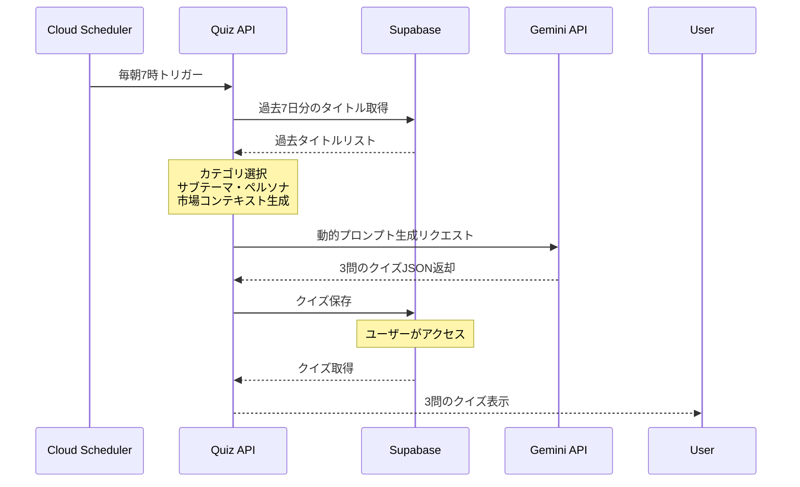

# 機能詳細

AI投資パートナーの4つの主要機能を詳しく解説します。

---

## 1. AI投資スタイル診断

### 概要

9つの質問に回答するだけで、AIがあなたの投資傾向を分析し、8つの投資家タイプに分類します。

### 質問内容

| # | カテゴリ | 質問 | 選択肢例 |
|---|---------|------|---------|
| 1 | 投資地域 | どの地域に投資したい？ | 日本株のみ / 米国株中心 / グローバル分散 |
| 2 | 投資期間 | どのくらいの期間で考えている？ | 短期（〜1年）/ 中期（1-5年）/ 長期（5年以上） |
| 3 | 投資スタイル | どんなスタイルで投資したい？ | 積極的に売買 / バランス型 / 基本は放置 |
| 4 | リスク許容度 | リスクをどこまで取れる？ | 高リスク高リターン / 中程度 / 安全重視 |
| 5 | 投資予算 | 月々いくら投資できる？ | 〜1万円 / 1-5万円 / 5万円以上 |
| 6 | 投資目的 | 投資の目的は？ | 資産形成 / 副収入 / 学習目的 |
| 7 | 下落時行動 | 株価が下がったらどうする？ | 買い増し / 様子見 / 損切り |
| 8 | 情報収集 | 情報収集はどうしてる？ | SNS / ニュースサイト / 専門メディア |
| 9 | 市場変動 | 市場変動にどう対応する？ | 積極的に売買 / 一部調整 / 変更しない |

### 8つの投資家タイプ

| タイプ | 名前 | 特徴 | 代表的投資家 |
|--------|------|------|-------------|
| 1 | **バフェット型**<br/>価値の賢者 | 企業の本質的価値を重視、長期保有 | ウォーレン・バフェット |
| 2 | **リンチ型**<br/>成長の探求者 | 日常生活から成長企業を発掘 | ピーター・リンチ |
| 3 | **ソロス型**<br/>相場の読み師 | マクロ経済分析、短中期売買 | ジョージ・ソロス |
| 4 | **グレアム型**<br/>堅実な分析家 | 安全域重視、配当重視 | ベンジャミン・グレアム |
| 5 | **オニール型**<br/>モメンタム追従者 | テクニカル＋ファンダメンタル | ウィリアム・オニール |
| 6 | **テンプルトン型**<br/>逆張りの勇者 | 下落時買い、逆張り投資 | ジョン・テンプルトン |
| 7 | **ボーグル型**<br/>インデックス信者 | 低コスト分散投資、長期運用 | ジョン・ボーグル |
| 8 | **ダリオ型**<br/>全天候型戦略家 | 資産クラス分散、リスク分散 | レイ・ダリオ |

### 診断結果に含まれる情報

```
┌─────────────────────────────────────────┐
│  あなたは「バフェット型（価値の賢者）」です  │
├─────────────────────────────────────────┤
│                                         │
│  📝 説明（300文字）                      │
│  企業の本質的な価値を見極め、長期的な...   │
│                                         │
│  💬 投資格言                             │
│  「他人が貪欲なときに恐れ、他人が恐れて... │
│                                         │
│  ✅ 強み（3つ）                          │
│  ・企業分析力が高い                      │
│  ・感情に左右されにくい                  │
│  ・長期的視野で判断できる                │
│                                         │
│  ⚠️ 注意点（3つ）                        │
│  ・短期的なチャンスを逃しやすい          │
│  ・分析に時間がかかりすぎる              │
│  ・成長株を見逃す可能性                  │
│                                         │
│  💡 投資行動アドバイス                   │
│  ・四半期決算をしっかり確認しましょう    │
│  ・PERやPBRを重視して銘柄選定を          │
│                                         │
│  🏭 推奨セクター                         │
│  金融 / 消費財 / ヘルスケア              │
│                                         │
│  📊 参考銘柄                             │
│  ・7203 トヨタ自動車（安定した収益基盤） │
│  ・8306 三菱UFJ（高配当、割安感）        │
│  ・4502 武田薬品（グローバル展開）       │
│                                         │
└─────────────────────────────────────────┘
```

### UI/UXの特徴

| 特徴 | 説明 |
|------|------|
| **プログレスバー** | 6段階で進捗を可視化 |
| **絵文字アイコン** | 各選択肢に視覚的なアクセント |
| **戻るボタン** | いつでも前の質問に戻れる |
| **ログイン不要** | 気軽に診断を試せる |
| **ローカル保存** | 未ログインでもlocalStorageに保存 |
| **回答キャッシュ** | 同一回答はサーバーキャッシュから即時返却（Gemini API 呼び出しなし） |

---

## 2. デイリーニュースクイズ

### 概要

毎朝7時（JST）に自動生成される、**3問構成**の投資学習クイズです。時事ニュース、行動経済学、過去の市場イベント、基本知識、シナリオ思考の5つのカテゴリから、毎日異なる組み合わせで出題されます。

### クイズの仕組み



### 5つのクイズカテゴリ

| カテゴリ | 目的 | サブテーマ例 |
|---------|------|-------------|
| **📰 時事（news）** | 最新ニュースの影響を予測 | Google検索で取得した実際のニュース |
| **🧠 心理（psychology）** | 行動経済学の罠を理解 | プロスペクト理論、損失回避バイアス、アンカリング効果 |
| **🕐 歴史（history）** | 過去の教訓から学ぶ | リーマンショック、ITバブル崩壊、コロナショック |
| **📚 基本（basic）** | 投資の基礎知識を習得 | PER、PBR、ROE、NISA制度、ドルコスト平均法 |
| **🎯 シナリオ（scenario）** | 実践的な投資判断を磨く | 決算発表後の急落対応、含み損銘柄の損切り判断 |

### クイズのコンテンツ

各クイズには以下の要素が含まれます：

| 要素 | 内容 |
|------|------|
| **タイトル** | 20文字以内の簡潔な見出し |
| **質問** | 100文字程度、読者に考えさせる問いかけ |
| **選択肢** | 3つの選択肢（id: 1, 2, 3） |
| **正解解説** | 150文字程度、学びのポイントを明確に |

### 動的生成の仕組み

毎日のクイズは以下のパラメータで動的に生成されます：

| パラメータ | 説明 | 例 |
|-----------|------|-----|
| **カテゴリ選択** | news は固定、残り2つはランダム | news + psychology + basic |
| **サブテーマ** | 各カテゴリから1つ選択 | psychology: 「プロスペクト理論」 |
| **市場コンテキスト** | 8種類からランダム選択 | 「歴史的な円安が進行中」 |
| **ペルソナ** | 5種類からランダム選択 | 「30代共働き夫婦、子ども1人、貯金300万円」 |
| **重複回避** | 過去7日分のタイトルを参照 | 似たような問題を出さない |

### クイズ画面イメージ

```
┌─────────────────────────────────────────┐
│  📰 今日のクイズ（3問）                   │
├─────────────────────────────────────────┤
│                                         │
│  ┌────┬────┬─────────┐                │
│  │時事│基本│シナリオ │  ← タブナビゲーション│
│  └────┴────┴─────────┘                │
│  （未回答: ⚪ / 正解: ✓ / 不正解: ✗）    │
│                                         │
│  ─────────────────────────────────────  │
│                                         │
│  📰 時事クイズ                           │
│                                         │
│  📌 日銀が金利据え置き決定               │
│                                         │
│  ❓ この決定は円相場にどう影響する？      │
│                                         │
│  ┌─────────────────────────────────┐   │
│  │  1. 円高が進む                   │   │
│  └─────────────────────────────────┘   │
│  ┌─────────────────────────────────┐   │
│  │  2. 円安が進む（選択中）         │   │
│  └─────────────────────────────────┘   │
│  ┌─────────────────────────────────┐   │
│  │  3. 大きな変化はない             │   │
│  └─────────────────────────────────┘   │
│                                         │
│  [ 回答する ]                           │
│                                         │
└─────────────────────────────────────────┘
```

### ゲーミフィケーション要素

| 要素 | 詳細 |
|------|------|
| **1問正解報酬** | +10 EXP |
| **全問正解ボーナス** | +15 EXP（3問すべて正解で追加獲得） |
| **最大獲得EXP** | 45 EXP（3問正解 30 + ボーナス 15） |
| **レベルアップ** | 100 EXPでレベル+1 |

**経験値の計算例：**
- 3問中2問正解：20 EXP
- 3問すべて正解：30 + 15 = **45 EXP**

### 回答後の表示

**個別クイズの回答結果：**

```
┌─────────────────────────────────────────┐
│  ✅ 正解！                               │
├─────────────────────────────────────────┤
│                                         │
│  🎉 +10 EXP 獲得！                       │
│                                         │
│  📝 解説                                 │
│  金利据え置きは市場予想通りのため、円相場  │
│  への影響は限定的です。むしろ米国との金利  │
│  差が継続するため、緩やかな円安傾向が...  │
│                                         │
└─────────────────────────────────────────┘
```

**全問正解時の特別表示：**

```
┌─────────────────────────────────────────┐
│  🎊 全問正解！パーフェクト達成！          │
├─────────────────────────────────────────┤
│                                         │
│  🏆 ボーナス +15 EXP 獲得！              │
│  📊 合計 +45 EXP                        │
│                                         │
│  素晴らしい！投資家としての洞察力が       │
│  着実に成長しています。                  │
│                                         │
└─────────────────────────────────────────┘
```

---

## 3. 学習ダッシュボード

### 概要

ユーザーの学習進捗を一目で把握できるパーソナルページです。

### 表示内容

```
┌─────────────────────────────────────────┐
│  👤 山田太郎                            │
│                                         │
│  🏆 Lv.5                                │
│  ████████████░░░░░░░░  45/100 EXP       │
│                                         │
│  📊 投資家タイプ: バフェット型           │
├─────────────────────────────────────────┤
│                                         │
│  📈 診断結果サマリー                     │
│  ─────────────────────────────────────  │
│  価値の賢者として、企業の本質的価値を    │
│  見極める力があります。                  │
│                                         │
│  🏭 推奨セクター                         │
│  [金融] [消費財] [ヘルスケア]           │
│                                         │
│  📊 推奨銘柄                             │
│  ・7203 トヨタ自動車                    │
│  ・8306 三菱UFJ                         │
│  ・4502 武田薬品                        │
│                                         │
│  🔄 もう一度診断する →                   │
│                                         │
├─────────────────────────────────────────┤
│                                         │
│  📰 今日のクイズ結果                     │
│  ─────────────────────────────────────  │
│  ✅ 正解！ +10 EXP                       │
│                                         │
│  解説: 新工場建設は設備投資として...     │
│                                         │
└─────────────────────────────────────────┘
```

### レベルシステム

| レベル | 必要EXP | 称号（将来実装） |
|--------|---------|----------------|
| Lv.1 | 0 | ルーキー投資家 |
| Lv.5 | 400 | 見習いトレーダー |
| Lv.10 | 900 | アナリスト候補 |
| Lv.20 | 1,900 | 中堅投資家 |
| Lv.50 | 4,900 | ベテラン投資家 |
| Lv.100 | 9,900 | マスター投資家 |

### 未診断ユーザーへのCTA

診断を受けていないユーザーには、専用のバナーを表示：

```
┌─────────────────────────────────────────┐
│  🎯 投資スタイル診断を受けよう！         │
│                                         │
│  9つの質問であなたの投資タイプを発見。   │
│  自分に合った投資スタイルを見つけよう。  │
│                                         │
│  [ 無料で診断を受ける → ]               │
└─────────────────────────────────────────┘
```

---

## 3. 市場解説

### 概要

日経平均が前日比-2.0%以上下落した日に、AIが初心者向けの分かりやすい解説を自動生成します。

**目的**:
- 下落時のパニック売りを防ぐ
- 市場の読み解き方を学ぶ
- 冷静な投資判断を支援

**表示場所**:
- ホームページ（下落日のみプレビュー表示）
- 専用ページ（/market-insights）

---

### 3.1 機能詳細

#### 解説内容の構成

1. **概要セクション**
   - 日経平均終値・変動率
   - 100文字以内の下落概要

2. **下落要因セクション**（3-5個）
   - カテゴリ：米国市場、為替、マクロ経済、セクター、その他
   - 各要因の詳細説明（200文字以内）

3. **チェックリストセクション**（5項目）
   - 「バーゲンセールか底なし沼か」を判断する質問形式
   - 各項目にガイダンス（300文字以内）
   - 警告サイン（底なし沼の兆候）をフラグ表示

4. **シナリオセクション**
   - **強気シナリオ**: 反発の条件・見通し
   - **弱気シナリオ**: 続落の条件・リスク
   - 各シナリオに3つの実現条件

5. **初心者向けアドバイスセクション**
   - **すべきこと**（3つ）
   - **してはいけないこと**（3つ）

6. **セクター別影響分析**（将来の拡張用）
   - 注目セクター3つを抽出
   - プラス/マイナス/中立の影響を表示

---

### 3.2 データフロー

```
1. Cloud Scheduler (平日16時JST)
   ↓
2. Yahoo Finance API
   ↓ 日経平均データ取得
3. 下落判定 (-2.0%以上?)
   ↓ Yes
4. Gemini API
   ↓ 解説生成
5. Supabase (market_analyses)
   ↓ 保存
6. フロントエンド表示
```

---

### 3.3 技術仕様

#### データベース

**テーブル**: `market_analyses`

| カラム名 | 型 | 説明 |
|---------|-----|------|
| id | UUID | 主キー |
| date | DATE | 解説日付（ユニーク） |
| nikkei_close | DECIMAL(10,2) | 日経平均終値 |
| nikkei_change_percent | DECIMAL(5,2) | 前日比変動率 |
| analysis_content | JSONB | 解説コンテンツ |
| created_at | TIMESTAMPTZ | 作成日時 |

#### API

- `GET /api/market-analysis` - 最新解説取得
- `GET /api/market-analysis?date=YYYY-MM-DD` - 日付指定取得
- `GET /api/market-analysis/dates` - 解説が存在する日付リスト
- `POST /api/cron/generate-market-analysis` - バッチ生成

---

### 3.4 UI/UX

#### ホームページプレビュー

下落日のみ表示：
- グラデーション背景（赤系）
- 変動率を大きく表示
- 概要を1-2文で要約
- 「詳しく見る」リンク

#### 専用ページ（/market-insights）

5つのセクションをカード形式で表示：
- 概要（グラデーション背景）
- 下落要因（カテゴリアイコン付き）
- チェックリスト（警告サインを色分け）
- シナリオ（ブル・ベア並列表示）
- アドバイス（dos/donts 2カラム）

#### 日付切り替え

- 過去30日分の解説をタブで切り替え
- 選択日付をハイライト表示

---

### 3.5 初心者への配慮

#### 平易な言葉

- 専門用語は文脈から理解できるように説明
- 中学生でも理解できる表現

#### パニック防止

- 「買え」「売れ」といった投資助言は禁止
- 冷静な判断を促すトーン
- 長期視点の重要性を強調

#### 学びのポイント

- 市場の読み解き方を教える
- チェックリスト形式で思考プロセスを提示
- ブル・ベアの両面シナリオで多角的視点を養う

---

## 機能比較表

| 機能 | ログイン不要 | ログイン必須 |
|------|:-----------:|:-----------:|
| 診断を受ける | ✅ | ✅ |
| 診断結果を保存 | △（ローカル） | ✅（クラウド） |
| クイズに挑戦 | ✅ | ✅ |
| EXP・レベル保存 | ❌ | ✅ |
| 市場解説閲覧 | ✅ | ✅ |
| ダッシュボード | ❌ | ✅ |

---

## 関連ドキュメント

- [ユーザージャーニー](./USER_JOURNEY.md) - 体験フロー図
- [KPI・指標](./METRICS.md) - 機能ごとの成功指標
