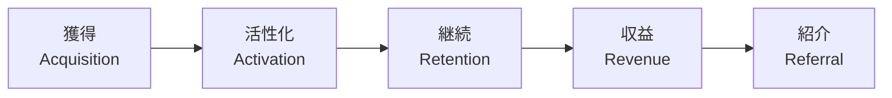
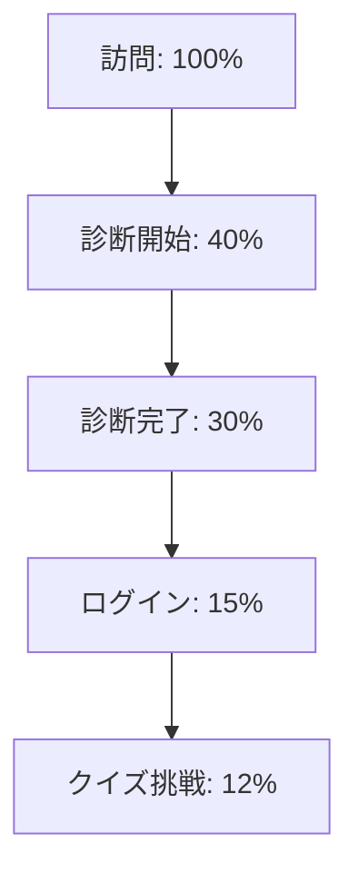

# KPI・指標

AI投資パートナーの成功を測定するためのKPIと指標を定義します。

---

## KPI概要

### North Star Metric（最重要指標）

| 指標 | 定義 | 目標 |
|------|------|------|
| **週間アクティブ学習者数（WAL）** | 週に1回以上クイズに回答したユーザー数 | - |

**選定理由**: クイズへの参加は「学習の継続」を示し、サービスの本質的価値（投資判断力の向上）と直結するため。

---

## KPIカテゴリ



---

## 1. 獲得（Acquisition）

### 指標一覧

| 指標 | 定義 | 計測方法 |
|------|------|---------|
| **訪問者数（UU）** | ユニークビジター数 | Google Analytics |
| **新規ユーザー数** | 初回訪問ユーザー数 | GA |
| **流入経路別訪問数** | チャネル別の訪問数 | GA |

### 目標設定（例）

| 指標 | 月間目標 | 備考 |
|------|---------|------|
| 訪問者数 | 10,000 UU | ローンチ3ヶ月後 |
| 新規ユーザー率 | 60% | 成長フェーズ |
| オーガニック流入率 | 40% | SEO効果 |

---

## 2. 活性化（Activation）

### 指標一覧

| 指標 | 定義 | 計測方法 |
|------|------|---------|
| **診断開始率** | 訪問者のうち診断を開始した割合 | イベントトラッキング |
| **診断完了率** | 診断開始者のうち完了した割合 | イベントトラッキング |
| **クイズ挑戦率** | 訪問者のうちクイズに挑戦した割合 | イベントトラッキング |
| **ログイン率** | 体験後にログインした割合 | 認証イベント |

### ファネル分析



### 目標設定（例）

| 指標 | 目標 | 備考 |
|------|------|------|
| 診断開始率 | 40% | CTAの最適化 |
| 診断完了率 | 75% | 離脱防止 |
| ログイン率 | 50% | 診断完了者対象 |
| クイズ挑戦率 | 80% | ログインユーザー対象 |

---

## 3. 継続（Retention）

### 指標一覧

| 指標 | 定義 | 計測方法 |
|------|------|---------|
| **DAU** | 日次アクティブユーザー | ログイン + 行動 |
| **WAU** | 週次アクティブユーザー | ログイン + 行動 |
| **MAU** | 月次アクティブユーザー | ログイン + 行動 |
| **DAU/MAU比率** | スティッキネス | 計算 |
| **7日継続率** | 登録7日後にアクティブな割合 | コホート分析 |
| **30日継続率** | 登録30日後にアクティブな割合 | コホート分析 |

### リテンションカーブ

```
継続率
100% │●
     │ ●
 80% │   ●
     │     ●
 60% │       ●
     │         ●───────────────
 40% │                         目標ライン
     │
 20% │
     │
  0% └─────────────────────────────→ 日数
       1  3  7  14  21  30
```

### 目標設定（例）

| 指標 | 目標 | 業界ベンチマーク |
|------|------|----------------|
| DAU/MAU | 20% | 教育アプリ: 15-25% |
| 7日継続率 | 40% | 一般アプリ: 20-30% |
| 30日継続率 | 20% | 一般アプリ: 10-15% |

---

## 4. エンゲージメント

### 指標一覧

| 指標 | 定義 | 計測方法 |
|------|------|---------|
| **クイズ正解率** | 正解数 / 回答数 | DB集計 |
| **平均回答時間** | クイズ回答までの時間 | イベントトラッキング |
| **連続参加日数** | 連続してクイズに参加した日数 | DB集計 |
| **平均レベル** | 全ユーザーの平均レベル | DB集計 |
| **レベル分布** | 各レベルのユーザー数 | DB集計 |

### レベル分布（目標）

```
ユーザー数
     │
     │ ████████████  Lv.1-5: 50%
     │ ████████      Lv.6-10: 30%
     │ ████          Lv.11-20: 15%
     │ ██            Lv.21+: 5%
     └───────────────────────────→ レベル
```

---

## 5. 機能別KPI

### AI投資スタイル診断

| 指標 | 定義 | 目標 |
|------|------|------|
| 診断完了数 | 日次の診断完了数 | - |
| 完了率 | 開始→完了の割合 | 75% |
| 平均所要時間 | 診断にかかる時間 | 3分以内 |
| 再診断率 | 2回以上診断したユーザー割合 | 10% |

### デイリーニュースクイズ

| 指標 | 定義 | 目標 |
|------|------|------|
| 日次回答数 | 1日あたりのクイズ回答数 | - |
| 正解率 | 全体の正解率 | 60% |
| 解説閲読率 | 解説を最後まで読んだ割合 | 80% |
| 連続参加率 | 3日以上連続参加の割合 | 30% |

### ダッシュボード

| 指標 | 定義 | 目標 |
|------|------|------|
| 訪問頻度 | ユーザーあたりの月間訪問回数 | 8回 |
| 滞在時間 | ダッシュボードでの滞在時間 | 2分 |
| 再診断クリック率 | 「もう一度診断」のクリック率 | 5% |

---

## 6. 技術指標

### パフォーマンス

| 指標 | 定義 | 目標 |
|------|------|------|
| **ページロード時間** | LCP（Largest Contentful Paint） | 2.5秒以内 |
| **インタラクティブ時間** | TTI（Time to Interactive） | 3.8秒以内 |
| **APIレスポンス時間** | 95パーセンタイル | 500ms以内 |
| **エラー率** | 5xx エラーの割合 | 0.1%以下 |

### インフラ

| 指標 | 定義 | 目標 |
|------|------|------|
| **可用性** | アップタイム | 99.9% |
| **月間コスト** | インフラ運用費 | 無料枠内 |
| **Gemini API使用量** | 日次リクエスト数 | 1,500以下 |

---

## 7. ビジネス指標（将来）

### 収益化後

| 指標 | 定義 | 備考 |
|------|------|------|
| **MRR** | 月次経常収益 | サブスク導入時 |
| **ARPU** | ユーザーあたり収益 | 広告/課金 |
| **LTV** | 顧客生涯価値 | ARPU × 平均継続期間 |
| **CAC** | 顧客獲得コスト | 広告費 / 新規ユーザー |
| **LTV/CAC** | 投資効率 | 3倍以上が目安 |

---

## ダッシュボード構成案

### エグゼクティブダッシュボード

| セクション | 指標 |
|-----------|------|
| **ヘッダー** | WAL（North Star）、前週比 |
| **獲得** | 訪問者数、新規ユーザー数 |
| **活性化** | 診断完了数、ログイン数 |
| **継続** | DAU、7日継続率 |

### オペレーションダッシュボード

| セクション | 指標 |
|-----------|------|
| **クイズ** | 日次回答数、正解率 |
| **診断** | 日次完了数、タイプ分布 |
| **技術** | エラー率、レスポンス時間 |

---

## 計測ツール

| 目的 | ツール | 備考 |
|------|--------|------|
| **アクセス解析** | Google Analytics 4 | 無料 |
| **イベントトラッキング** | GA4 + カスタムイベント | - |
| **エラー監視** | Cloud Logging | GCP |
| **パフォーマンス** | Lighthouse CI | GitHub Actions |
| **データ分析** | Supabase + SQL | DB直接 |

---

## レポーティング

### 週次レポート

| 項目 | 内容 |
|------|------|
| **サマリー** | WAL、前週比、トレンド |
| **獲得** | 流入数、チャネル別 |
| **活性化** | ファネル分析 |
| **継続** | リテンションカーブ |
| **アクション** | 来週の改善施策 |

### 月次レポート

| 項目 | 内容 |
|------|------|
| **サマリー** | MAU、成長率、目標達成率 |
| **コホート分析** | 月別リテンション |
| **機能分析** | 各機能の利用状況 |
| **インサイト** | ユーザー行動の発見 |
| **ロードマップ** | 来月の優先施策 |

---

## 関連ドキュメント

- [ユーザージャーニー](./USER_JOURNEY.md) - ファネルの詳細
- [機能詳細](./FEATURES.md) - 各機能のKPI対象
