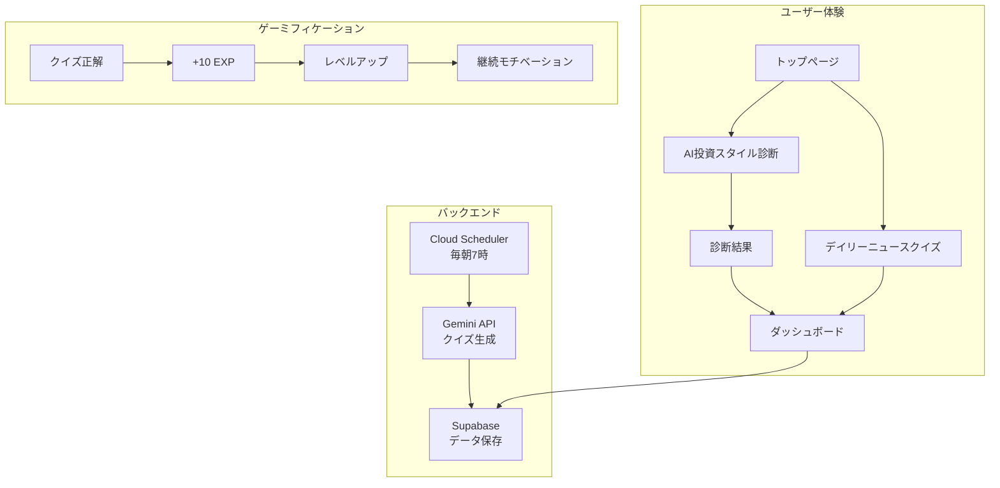

# プロダクト概要

## ミッション

> **「銘柄を教えるのではなく、選び方と読み解き方を教える」**

AI投資パートナーは、投資初心者が自立した投資判断ができるようになることを目指す**学習支援プラットフォーム**です。

---

## プロダクトコンセプト

### 従来の投資アプリの課題

| 課題 | 詳細 |
|------|------|
| 銘柄推奨への依存 | 「この銘柄を買え」と言われても、なぜ買うのか理解できない |
| 情報の難解さ | 専門用語が多く、初心者には敷居が高い |
| 継続の難しさ | 学習のモチベーションが続かない |
| 自己分析の欠如 | 自分の投資スタイルがわからないまま始めてしまう |

### 私たちのアプローチ

```
従来: 「この株を買いなさい」→ 結果に依存
  ↓
私たち: 「あなたはこういう投資家タイプです」
       「このニュースはこう読み解きます」
       → 判断力を養成
```

---

## 提供価値

### ユーザーへの価値

| 価値 | 詳細 |
|------|------|
| **自己理解** | AI診断で自分の投資スタイルを発見 |
| **実践的学習** | 実際のニュースで投資判断を練習 |
| **継続のしやすさ** | ゲーミフィケーションで毎日5分の習慣化 |
| **成長の実感** | レベル・経験値で成長を可視化 |

### ビジネスへの価値

| 価値 | 詳細 |
|------|------|
| **低コスト運用** | GCP無料枠内で運用可能 |
| **スケーラブル** | サーバーレスで自動スケール |
| **データ資産** | ユーザーの投資傾向データを蓄積 |
| **拡張性** | 有料機能追加やB2B展開に対応可能 |

---

## サービス概要図



---

## 3つの主要機能

### 1. AI投資スタイル診断

9つの質問に回答するだけで、Gemini AIがあなたを**8つの投資家タイプ**に分類。

- バフェット型、リンチ型、ソロス型など、有名投資家にちなんだタイプ
- 強み・注意点・推奨セクター・参考銘柄を提供
- **ログイン不要**で気軽に体験可能

### 2. デイリーニュースクイズ

毎朝7時に自動生成される、その日のニュースに関するクイズ。

- 「このニュースは株価にポジティブ？ネガティブ？」を3択で回答
- 正解すると**+10 EXP**、参加だけでも**+2 EXP**
- 連続正解ボーナスで習慣化を促進

### 3. 学習ダッシュボード

あなたの学習進捗を一目で把握。

- 現在のレベルと経験値をプログレスバーで表示
- 診断結果のサマリー
- 今日のクイズ結果と解説

---

## 技術的な強み

### AI活用の効率化

| 技術 | 活用方法 |
|------|---------|
| **Gemini API** | 診断の個別化、クイズの自動生成 |
| **JSON Schema** | AI出力を構造化して品質を担保 |
| **バッチ処理** | 朝1回の生成で全ユーザー対応（コスト最適化） |

### ゲーミフィケーション設計

| 要素 | 効果 |
|------|------|
| **レベルシステム** | 長期的な成長目標を設定 |
| **経験値** | 短期的な達成感を提供 |
| **連続ボーナス** | 習慣化を促進 |

### 摩擦の少ないUX

| 設計 | 効果 |
|------|------|
| **ログイン不要** | 初期体験のハードルを下げる |
| **Googleログイン** | 登録の手間を最小化 |
| **自動データ同期** | ゲスト→ログイン時のデータ引き継ぎ |

---

## 数字で見るサービス設計

| 項目 | 数値 |
|------|------|
| 診断質問数 | 9問 |
| 投資家タイプ | 8タイプ |
| クイズ選択肢 | 3択 |
| 正解時EXP | +10 |
| 参加時EXP | +2 |
| レベルアップ | 100 EXP |
| クイズ生成 | 毎朝7時 |

---

## 想定される拡張

### 短期（〜6ヶ月）
- ランキング機能（ユーザー間競争）
- 診断結果のSNSシェア
- プッシュ通知（クイズリマインダー）

### 中期（6ヶ月〜1年）
- セクター別深掘り学習コース
- 仮想ポートフォリオ機能
- コミュニティ機能

### 長期（1年〜）
- 法人向け金融リテラシー研修
- 証券会社との連携
- 海外展開（英語対応）

---

## 関連ドキュメント

- [機能詳細](./FEATURES.md) - 各機能の詳細説明
- [ユーザージャーニー](./USER_JOURNEY.md) - 体験フロー
- [競合分析](./COMPETITIVE_ANALYSIS.md) - 市場でのポジション
