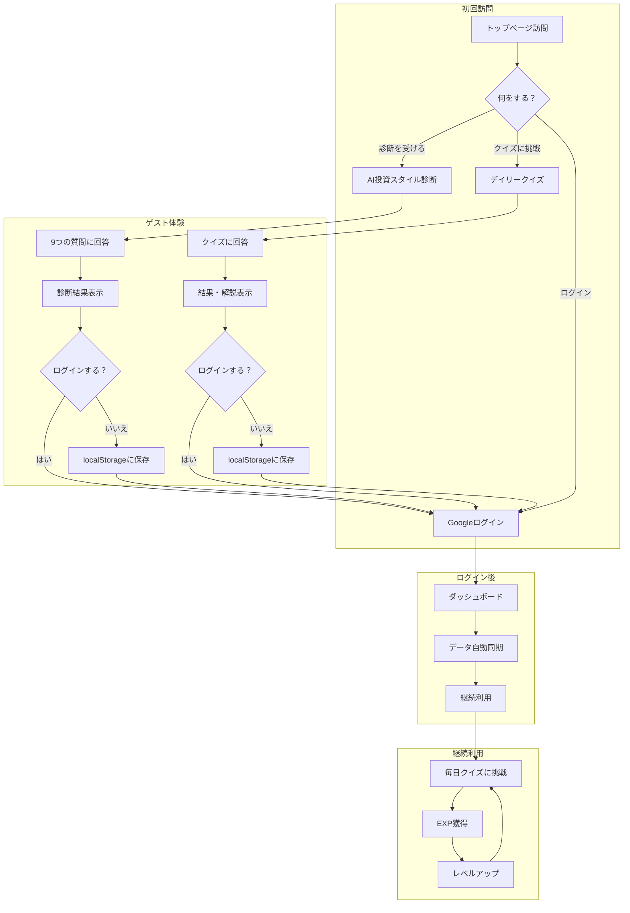
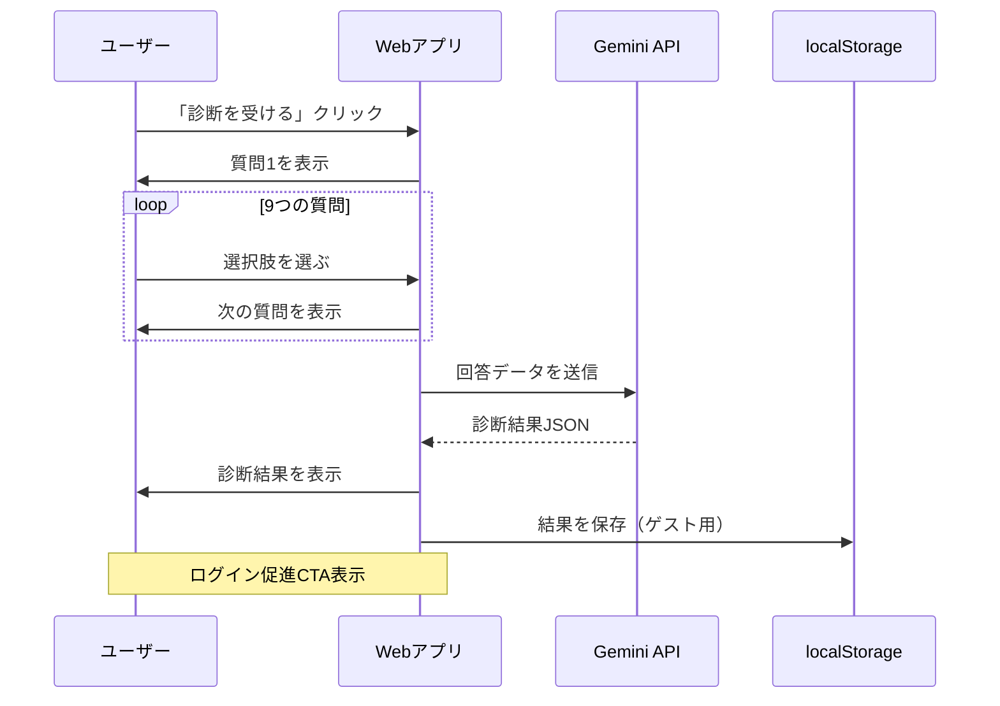
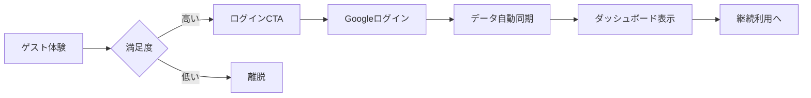
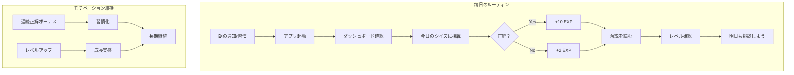
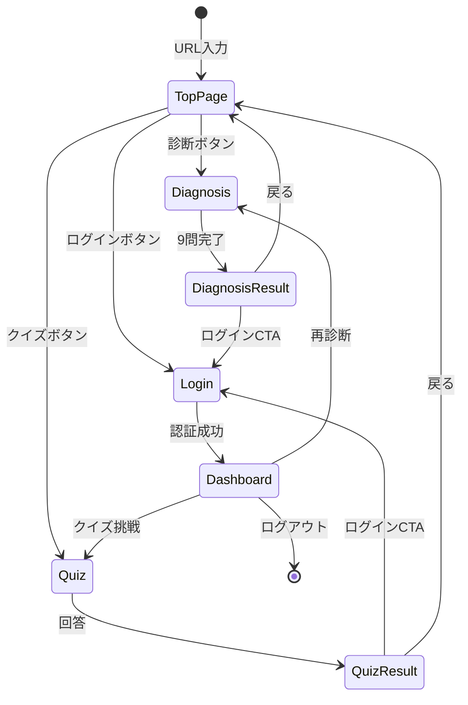

# ユーザージャーニー

ユーザーがAI投資パートナーを利用する際の体験フローを解説します。

---

## 全体フロー

---

## ジャーニーマップ詳細

### Phase 1: 認知・初回訪問

| ステップ | ユーザー行動 | 感情 | タッチポイント |
|---------|------------|------|--------------|
| 1 | SNS/検索でサービスを発見 | 興味 | 広告、検索結果 |
| 2 | トップページにアクセス | 期待 | LP |
| 3 | サービス内容を確認 | 理解 | LP説明文 |

**コンバージョンポイント**: 「無料で診断を受ける」ボタン

---

### Phase 2: 初回体験（ゲスト）

#### 診断フロー

| ステップ | ユーザー行動 | 感情 | 設計意図 |
|---------|------------|------|---------|
| 1 | 「診断を受ける」クリック | 好奇心 | ログイン不要で心理的ハードル低 |
| 2 | 9つの質問に回答 | 集中 | プログレスバーで残り把握 |
| 3 | 診断結果を確認 | 驚き・納得 | 個別化された結果で満足感 |
| 4 | 推奨銘柄を確認 | 興味 | 具体的なアクションにつながる |

**感情のピーク**: 診断結果表示時（「自分のことがわかった！」）

---

#### クイズフロー

| ステップ | ユーザー行動 | 感情 | 設計意図 |
|---------|------------|------|---------|
| 1 | クイズページにアクセス | 軽い興味 | 毎日新しい問題で新鮮さ |
| 2 | ニュースを読む | 学習 | 実際のニュースで実践的 |
| 3 | 選択肢を選ぶ | 緊張 | 3択で迷いすぎない |
| 4 | 結果を確認 | 達成感/悔しさ | 即座のフィードバック |
| 5 | 解説を読む | 納得 | 学びの定着 |

**感情のピーク**: 正解時の「+10 EXP」表示

---

### Phase 3: コンバージョン（ログイン）

#### ログイン促進のタイミング

| タイミング | メッセージ | 効果 |
|-----------|----------|------|
| 診断結果表示後 | 「結果を保存してダッシュボードで確認しよう」 | 高（満足度が高い瞬間） |
| クイズ正解後 | 「EXPを保存してレベルアップしよう」 | 中（達成感の活用） |
| 2回目訪問時 | 「前回の診断結果をクラウドに保存しませんか？」 | 高（継続意思の確認） |

---

### Phase 4: 継続利用

#### リテンション設計

| 要素 | 仕組み | 心理的効果 |
|------|-------|-----------|
| **毎日のクイズ** | 朝7時に新問題 | 新鮮さ、習慣化 |
| **連続ボーナス** | 3日/7日で追加EXP | 継続のインセンティブ |
| **レベルアップ** | 100 EXPごとに+1 | 成長の可視化 |
| **ダッシュボード** | 進捗の一覧表示 | 達成感の蓄積 |

---

## 画面遷移図

---

## タッチポイント別の体験設計

### 1. トップページ（LP）

| 要素 | 目的 |
|------|------|
| キャッチコピー | 価値提案の即座の理解 |
| 3つの機能紹介 | サービス全体像の把握 |
| 「無料で診断」CTA | コンバージョン（診断開始） |
| 「クイズに挑戦」CTA | 別の入口を提供 |

### 2. 診断ページ

| 要素 | 目的 |
|------|------|
| プログレスバー | 進捗の可視化、離脱防止 |
| 戻るボタン | 安心感、修正可能 |
| 絵文字アイコン | 視覚的な楽しさ |

### 3. 診断結果ページ

| 要素 | 目的 |
|------|------|
| 投資家タイプ名 | アイデンティティの付与 |
| 強み・注意点 | 自己理解の深化 |
| 推奨銘柄 | 具体的なアクションへ |
| ログインCTA | コンバージョン促進 |

### 4. クイズページ

| 要素 | 目的 |
|------|------|
| ニュース情報 | 学習コンテンツの提供 |
| 3択ボタン | 迷いすぎない設計 |
| EXP表示 | 即座の報酬感 |
| 解説 | 学びの定着 |

### 5. ダッシュボード

| 要素 | 目的 |
|------|------|
| レベル・EXP | 成長の可視化 |
| 診断サマリー | アイデンティティの確認 |
| 今日のクイズ | 日次アクションへ誘導 |

---

## 離脱ポイントと対策

| 離脱ポイント | 原因 | 対策 |
|------------|------|------|
| 診断の途中 | 質問が多い | プログレスバーで残り表示 |
| 診断結果後 | 満足して終了 | ログインCTA、クイズへの誘導 |
| クイズ不正解後 | 自信喪失 | 参加EXP付与、励ましメッセージ |
| 数日後 | 忘れる | （将来）プッシュ通知 |

---

## 関連ドキュメント

- [ターゲットペルソナ](./TARGET_PERSONA.md) - ユーザー像の詳細
- [機能詳細](./FEATURES.md) - 各画面の機能説明
- [KPI・指標](./METRICS.md) - 各フェーズの成功指標
