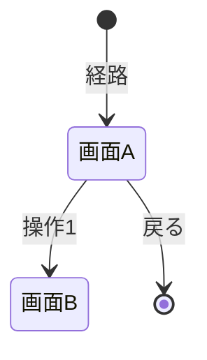

<!--
画面別仕様書テンプレート（MVP版）

使い方:
  1. このファイルをコピーし、ファイル名を画面に合わせて変更（kebab-case 推奨）
     例: cp _TEMPLATE.md diagnosis.md
  2. 各セクションの <!-- 記入指針 --> コメントを参考に内容を埋める
  3. 記入指針コメントは最終的に削除してOK（残しても表示には影響しない）
  4. スクリーンショットは images/{画面名}.png に配置（Playwright で本番URL撮影）
  5. 完成したら docs/specifications/README.md の一覧に追加
-->

---
screen_id: <!-- kebab-case の一意ID。例: news-article-detail -->
last_updated: <!-- YYYY-MM-DD 形式。更新時に必ず変更 -->
status: Draft  # Draft / Review / Approved
owner: <!-- 担当者の氏名または GitHub username -->
---

# <!-- 画面名（日本語） -->

<!-- 記入指針: 画面の目的・提供価値を2〜3行で。「誰が」「どんな課題を」「どう解決するか」を1文ずつ。 -->

---

## 対象ユーザー / 利用シーン

<!-- 記入指針:
  - 想定ペルソナを箇条書きで（投資初心者 / 学習継続者 / 管理者など）
  - どんなシーン・タイミングで開くかを1〜2行
  例:
  - **対象**: 投資初心者ユーザー（ログイン不要でも利用可）
  - **利用シーン**: 朝の通勤中、その日のニュースを5分でキャッチアップしたい時
-->

---

## 基本情報

| 項目 | 内容 |
|------|------|
| URL | <!-- 例: /news-articles/[date] --> |
| アクセス権限 | <!-- ゲスト可 / 要ログイン / 要管理者 --> |
| キャッシュ | <!-- ISR / SSR / CSR / 静的 --> |
| 動的パラメータ | <!-- 例: dynamicParams = true --> |
| 事前生成範囲 | <!-- 例: 直近30日分 / なし --> |

---

## スクリーンショット


> 撮影手順: 本番URL `https://money-nav.com/...` を Playwright CLI でデスクトップ撮影（1280×800、fullPage）

---

## 画面遷移図

<!-- 記入指針:
  - 主要な遷移を stateDiagram-v2 で表現
  - 入り口（[*]）と出口（[*]）を明示
  - ユーザー操作の結果として何が起こるかをラベルに書く
-->



---

## 画面構成

<!-- 記入指針: 上から下の表示順序でセクションを列挙。実装ファイルは web/src/ 配下を相対パス推奨。 -->

| # | セクション | 表示内容 | 実装 |
|---|-----------|---------|------|
| 1 | <!-- 例: ヘッダー --> | <!-- 表示するもの --> | <!-- ファイル/コンポーネント --> |

---

## データソース

<!-- 記入指針:
  - 使用するテーブル・APIを列挙
  - 主要カラム / クエリパラメータ / 結合ロジックを記載
-->

### テーブル / API

| 項目 | 用途 |
|------|------|
| <!-- table or endpoint --> | <!-- 何に使うか --> |

---

## データ生成タイミング

<!-- 記入指針:
  - Cron / ユーザー操作 / API呼び出し時など、データがいつ生成されるかを記載
  - 該当しない場合は「ユーザー操作時のみ取得」等
-->

---

## ユーザー操作と遷移

| 操作 | 遷移先 / 結果 |
|------|---------------|
| <!-- 例: ○○ボタンクリック --> | <!-- 例: /xxx へ遷移 --> |

---

## SEO / 構造化データ

<!-- 記入指針:
  - generateMetadata の有無
  - OGP画像の生成有無
  - JSON-LD の Schema.org タイプ
  該当なしの画面（管理画面など）は「noindex」と記載
-->

---

## エラーハンドリング

| 条件 | 挙動 |
|------|------|
| <!-- 例: パラメータ不正 --> | <!-- 例: notFound() → 404 --> |

---

## 関連ファイル

```
web/src/
├── app/...
├── views/...
├── widgets/...
└── ...
```

---

## 関連ドキュメント

- [データベース設計](../../architecture/DATABASE.md)
- [SEO最適化](../../development/SEO.md)
- <!-- 必要に応じて追加 -->
