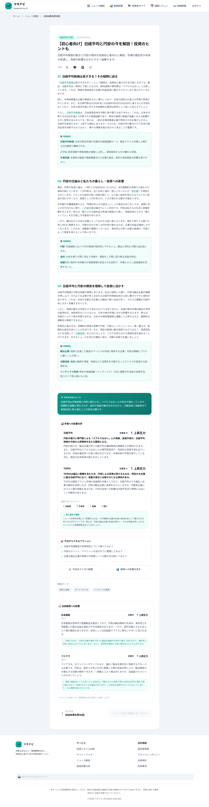
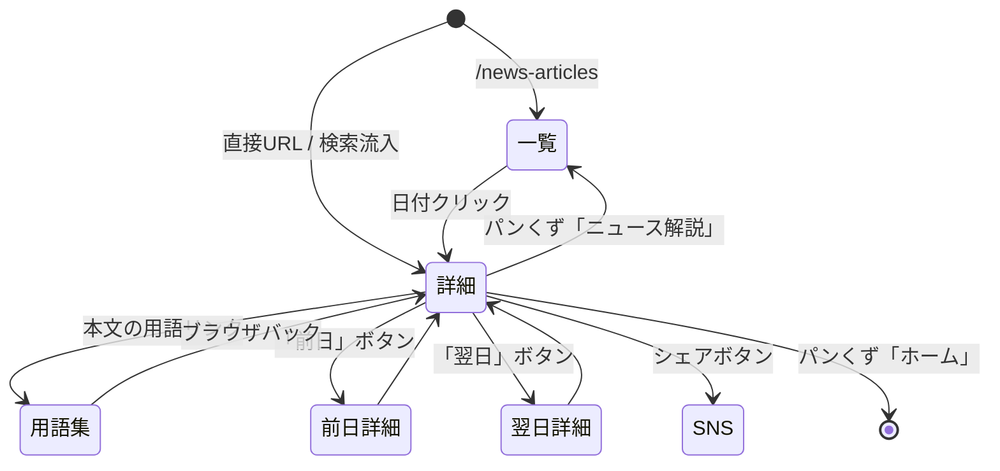

# ニュース解説記事 詳細ページ

毎日の市場ニュースをAIが投資初心者向けに解説する記事ページ。記事本文に加え、前後日付へのナビゲーションを表示し、初心者が「今日の市場で何が起きているか」を5分で把握できることを目的とする。

---

## 対象ユーザー / 利用シーン

- **対象ペルソナ**:
  - 投資初心者（ゲストユーザー含む。ログイン不要で閲覧可能）
  - 日々の市場ニュースをキャッチアップしたい学習継続層
- **利用シーン**:
  - 朝の通勤中、その日のニュースとマーケットの動きを確認したい時
  - 検索流入（記事URLを直接開く）からの初訪問
- **提供価値**:
  - ニュース → 解説、までを1ページで完結
  - 用語リンクで関連用語を辞書に飛ばし、学習を深められる

---

## 基本情報

| 項目 | 内容 |
|------|------|
| URL | `/news-articles/[date]`（例: `/news-articles/2026-05-16`） |
| アクセス権限 | 全員（ゲスト可・ログイン不要） |
| キャッシュ | ISR（`revalidate = 86400` / 1日） |
| 動的パラメータ | `dynamicParams = true`（事前生成外の日付も生成） |
| 事前生成範囲 | 直近30日分（`generateStaticParams` で `news_articles` から取得） |

---

## スクリーンショット



> 撮影手順: 本番URL `https://money-nav.com/news-articles/{最新日付}` を Playwright CLI でデスクトップ撮影（1280×800, fullPage）。
> 保存先: `docs/specifications/screens/images/news-article-detail.png`

---

## 画面遷移図



---

## 画面構成

上から下の表示順序。

| # | セクション | 表示内容 | 実装 |
|---|-----------|---------|------|
| 1 | パンくず | ホーム > ニュース解説 > {表示日付} | `Breadcrumbs`（`shared/ui/breadcrumbs`） |
| 2 | カテゴリ・日付バッジ | テーマ（例: 為替）と表示日付 | `NewsArticleCard` |
| 3 | タイトル | 記事タイトル（h1） | `NewsArticleCard` |
| 4 | サマリ | 1〜2文の要約 | `NewsArticleCard` |
| 5 | SNSシェアボタン | X / LinkedIn / コピー | `SocialShareButtons` |
| 6 | 本文セクション群 | `article_content.sections[]` を順次描画。重要用語は用語集にリンク | `ArticleSection` + `linkifyKeyTerms` |
| 7 | 投資家目線のまとめ | グラデーション背景の強調ボックス（`investorInsight`） | `NewsArticleCard` |
| 8 | 市場影響セクション | 任意。日経平均・為替などの値動きと解釈 | `MarketImpactSection` |
| 9 | アクションアイテム | 任意。初心者向けの具体的な行動提案 | `ActionItemsSection` |
| 10 | クロスリンク | 関連コンテンツ（市場解説・クイズ等）への導線 | `CrossLinkSection` |
| 11 | 関連トピック | `relatedTopics[]` のタグ表示 | `RelatedTopicsSection` |
| 12 | 日付ナビゲーション | 前日 / 翌日の記事へ遷移 | `DateNavigation` |

---

## データソース

### ページ本体 (`news_articles` テーブル)

| カラム | 用途 |
|--------|------|
| `date` | URL パラメータと一致するレコードを取得 |
| `article_content` (JSON) | タイトル・要約・本文セクション・関連トピック・アクション項目など、画面表示の主データ |
| `is_published` | （Cron側で参照。ページ表示では全件取得） |
| `created_at` | 構造化データ `dateModified` に使用 |

取得処理: `web/src/app/(main)/news-articles/[date]/page.tsx:112-116`

---

## データ生成タイミング

- **Cron**: 平日 07:00 JST に `POST /api/cron/generate-news-article` が実行
- **生成順序**:
  1. NewsAPI から市場ニュースを取得（最大10件）
  2. Gemini で記事本文を生成 → `news_articles` に `upsert`
  3. Slack 通知 + 検索エンジン通知（IndexNow）
- **金曜日のみ**: 上記に加え週間レビュー（`weekly_reviews`）も生成

実装: `web/src/app/api/cron/generate-news-article/route.ts`

---

## ユーザー操作と遷移

| 操作 | 遷移先 |
|------|--------|
| パンくず「ホーム」クリック | `/` |
| パンくず「ニュース解説」クリック | `/news-articles` |
| SNSシェアボタン | X / LinkedIn の共有ダイアログ・クリップボードコピー |
| 本文内の用語リンク | `/glossary/{slug}`（用語集ページ） |
| クロスリンク | 市場解説・クイズなど関連ページ |
| 日付ナビゲーション「前日」 | `/news-articles/{前日}` |
| 日付ナビゲーション「翌日」 | `/news-articles/{翌日}` |

---

## SEO / 構造化データ

- **Metadata**: `generateMetadata()` で `title` / `description` / OGP / Twitter Card / canonical を出力
- **OGP画像**: `/news-articles/{date}/opengraph-image`（1200×630 動的生成）
- **構造化データ（JSON-LD）**: `Schema.org/NewsArticle`
  - `headline` / `description` / `datePublished` / `dateModified` / `keywords` / `about` を出力
  - 実装: `web/src/views/news-articles/ui/NewsArticleDetailPage.tsx:11-37`

---

## エラーハンドリング

| 条件 | 挙動 |
|------|------|
| `date` が `YYYY-MM-DD` 形式でない | `notFound()` → 404 |
| `date` が未来日 | `notFound()` → 404 |
| `news_articles` に該当レコードなし | `notFound()` → 404 |
| `article_content` の JSON パース失敗 | `logger.error` を出力後 `notFound()` |

---

## 関連ファイル

```
web/src/
├── app/(main)/news-articles/[date]/page.tsx       # ルート（SSG + メタデータ）
├── views/news-articles/ui/
│   ├── NewsArticleDetailPage.tsx                  # ページコンポーネント
│   └── DateNavigation.tsx                         # 前後日ナビ
├── widgets/news-article-card/                     # 記事本文ウィジェット
│   ├── ui/NewsArticleCard.tsx
│   ├── ui/ArticleSection.tsx
│   ├── ui/MarketImpactSection.tsx
│   ├── ui/ActionItemsSection.tsx
│   ├── ui/CrossLinkSection.tsx
│   └── ui/RelatedTopicsSection.tsx
└── entities/news-article/                          # ドメインロジック・型変換
```

---

## 関連ドキュメント

- [データベース設計](../../architecture/DATABASE.md)
- [SEO最適化](../../development/SEO.md)
- [API一覧](../../reference/API.md)
